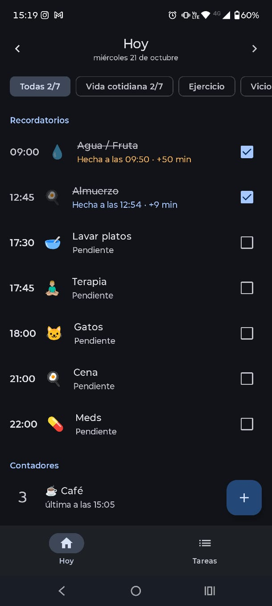
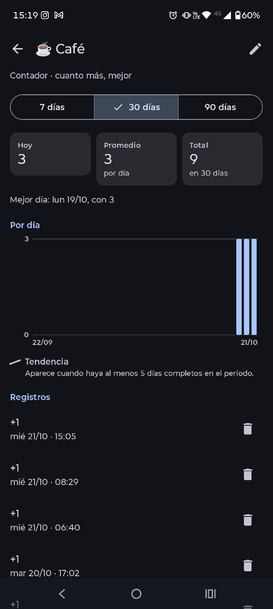
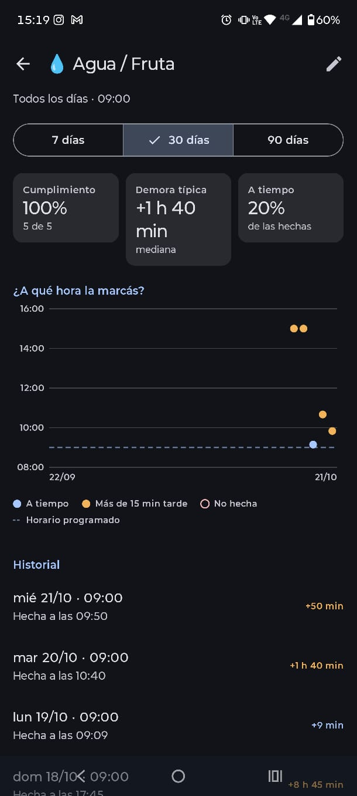
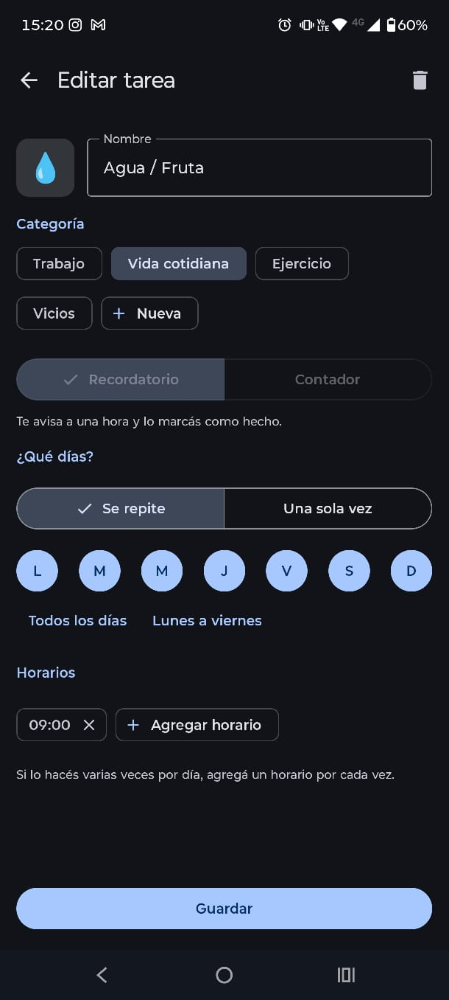
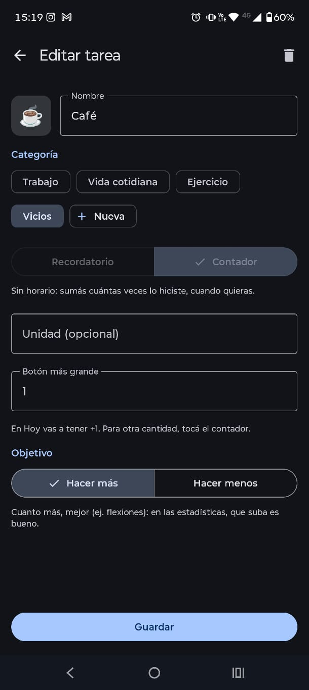

# Rutina

App de Android para llevar la rutina diaria: recordatorios con horario que avisan con una notificación, y contadores para anotar cuánto se hace de algo (flexiones, vasos de agua, cigarrillos…). Todo queda en el teléfono: no hay cuentas y la app no pide permiso de internet.

<p align="center">
  
  
  
  
  
</p>

## Qué hace

**Recordatorios**
- Una sola vez o los días de la semana que elijas, con uno o varios horarios por día.
- Avisan con una notificación que tiene un botón **Hecha**. También se pueden marcar desde la app, o anotar que se hicieron a otra hora.
- Estadísticas de 7, 30 o 90 días: cumplimiento, demora típica (la mediana), cuántas veces a tiempo (hasta 15 minutos tarde), el detalle por horario y el historial.

**Contadores**
- Cada uno tiene una unidad y un incremento, del que salen los botones rápidos (por ejemplo, un incremento de 10 da +1, +5 y +10).
- Tienen un objetivo: *hacer más* (flexiones) o *hacer menos* (cigarrillos). Con eso las estadísticas saben si un cambio es bueno o malo.
- Estadísticas: total, promedio por día y mejor día, todo contado desde el primer registro. Incluyen un gráfico por día con la **tendencia**, que dice si venís haciendo cada vez más, cada vez menos o sin un rumbo claro. La tendencia aparece desde los 5 días completos y no cuenta el día de hoy, que todavía no terminó.
- Un gráfico **por hora** suma lo de cada hora del día en todo el período, para ver en qué horarios se hace más (cuándo se fuma, a qué hora se toma café…).

**Categorías**
- Agrupan las tareas (Trabajo, Ejercicio…). En **Hoy** se puede filtrar por categoría y ver el avance de cada una.

**Widgets**
- **Contadores:** todos los contadores con el total de hoy y sus botones para sumar sin abrir la app.
- **Un contador:** uno solo, que se elige al agregar el widget.
- Los dos se actualizan solos al sumar (desde el widget o desde la app) y vuelven a cero a medianoche.

**Copias de seguridad**
- En el menú ⋮ de **Tareas**, *Exportar datos* guarda todo en un archivo donde elijas (Descargas, Drive…). *Importar datos* lo carga de vuelta, por ejemplo en un teléfono nuevo, y reemplaza lo que haya en la app.

## Requisitos

- **Para usarla:** Android 8.0 (API 26) o más nuevo.
- **Para compilarla:** una versión reciente de Android Studio, compatible con el Android Gradle Plugin 9.4, y el SDK de Android 37. Si falta algún componente del SDK, Android Studio ofrece instalarlo al sincronizar. Gradle viene con el proyecto (wrapper 9.6), y Android Studio trae su propio JDK. Si compilás por consola, necesitás JDK 17 o más nuevo.

## Compilar e instalar la versión de prueba (debug)

En Android Studio:

1. **File → Open** y elegí la carpeta del proyecto.
2. Esperá a que termine la sincronización de Gradle. Si no arranca sola, usá el botón del elefante (*Sync Project with Gradle Files*).
3. Conectá el teléfono con la depuración USB activada, o abrí un emulador, y tocá **Run ▶**.

Por consola:

```bash
./gradlew installDebug      # compila e instala en el teléfono conectado
./gradlew assembleDebug     # solo compila: app/build/outputs/apk/debug/app-debug.apk
```

La versión debug se instala como **Rutina debug**, una app aparte con sus propios datos. Sirve para probar cambios sin tocar la que usás todos los días.

## Tests

```bash
./gradlew test
```

Prueban la lógica de `domain/`: los horarios, las categorías y las estadísticas, incluida la tendencia.

## Versión release (para usar en el teléfono)

La release se minifica con R8 y se firma con una clave propia. La clave **no está en el repositorio**: la carpeta `firma/` está en el `.gitignore`. Sin ella, la release sale sin firmar y no se puede instalar.

### 1. Crear la clave (solo la primera vez)

Desde Android Studio, en **Build → Generate Signed App Bundle or APK → Create new…**, o por consola:

```bash
mkdir firma
keytool -genkeypair -v -keystore firma/rutina-release.jks -alias rutina \
        -keyalg RSA -keysize 2048 -validity 10000
```

Después creá `firma/firma.properties`:

```properties
storeFile=rutina-release.jks
storePassword=la-contraseña-del-almacén
keyAlias=rutina
keyPassword=la-contraseña-de-la-clave
```

`storeFile` se busca dentro de `firma/`.

> **Hacé un backup de la carpeta `firma/` fuera del repositorio** (un gestor de contraseñas, un pendrive…). Android solo instala una actualización encima de otra si las dos están firmadas con la misma clave. Si la perdés, para instalar una versión nueva vas a tener que desinstalar la app, y se borran los datos.

### 2. Compilar

En Android Studio:

1. **Build → Select Build Variant…** y elegí `release`.
2. **Build → Generate App Bundles or APKs → Generate APKs**.

Por consola:

```bash
./gradlew assembleRelease
```

El APK queda en `app/build/outputs/apk/release/app-release.apk`. Si en vez de ese aparece `app-release-unsigned.apk`, Gradle no encontró `firma/firma.properties`.

### 3. Instalar

- **Con cable:** `adb install -r app/build/outputs/apk/release/app-release.apk`
- **Sin cable:** pasá el APK al teléfono (Drive, Telegram, cable…) y abrilo. La primera vez Android pide permiso para instalar apps de ese origen.

Para actualizar, instalá el APK nuevo encima del anterior: los datos se conservan.

## Estructura

```
app/src/main/java/com/ignacio/rutina/
├── data/        Room: tareas, registros, categorías, migraciones y el repositorio
├── domain/      Lógica sin Android: horarios, estadísticas, tendencia, categorías
├── reminders/   Alarmas, notificaciones y reprogramación al reiniciar o cambiar la hora
├── ui/          Pantallas en Jetpack Compose (Hoy, Tareas, detalle, edición) y componentes
└── widget/      Widgets de la pantalla de inicio, hechos con Jetpack Glance
```

Tecnologías: Kotlin, Jetpack Compose con Material 3, Room, Jetpack Glance y AlarmManager para los avisos.

### Cambios en la base de datos

Room exporta el esquema de cada versión a `app/schemas/`, y esa carpeta va en el repositorio. Si cambiás una entidad de `data/`:

1. Subí la `version` en `RutinaDatabase`.
2. Escribí la `Migration` correspondiente y agregala con `addMigrations`.

Sin la migración, la app se cierra al abrirse en un teléfono que ya tenía datos.

### Reglas de R8

Si la release se comporta distinto que la debug, la causa suele estar en R8, que borra el código que se usa solo por reflexión. Las reglas propias van en `app/proguard-rules.pro`. Por ejemplo, ahí se conserva el constructor de las acciones de los widgets.
